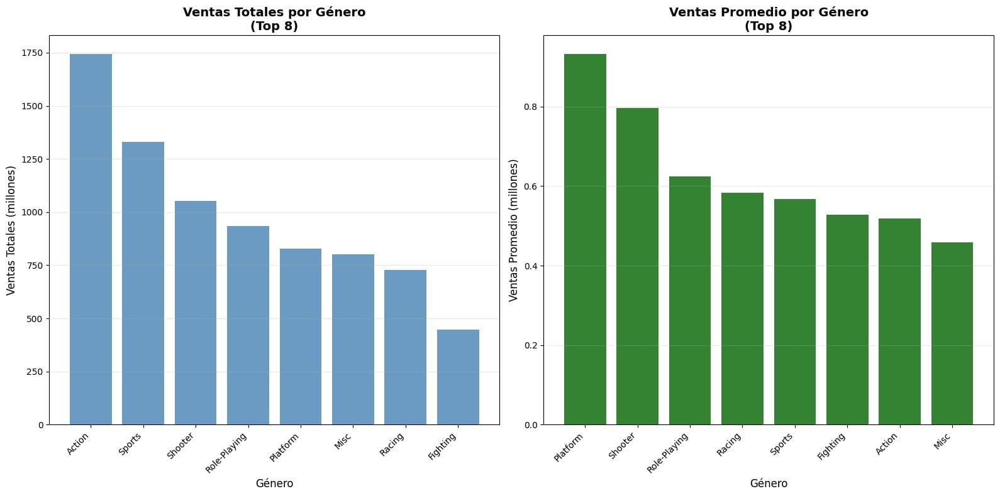

# 🎮 Análisis de Ventas de Videojuegos - Tienda ICE

> ¿En qué plataformas y géneros debe invertir ICE su presupuesto 2025 para no perder dinero?

🔗 **Notebook:** [Ver análisis completo]
📊 **Dataset:** Ventas globales de videojuegos 1980-2020

---

### 🎯 ¿Qué problema de negocio resuelve?

ICE es una tienda que compra inventario de videojuegos sin saber qué se vende.

**Mi rol:** Encontrar tendencias y comparar ventas entre consolas, saber cuanto influyen las reseñas y que compañía se mantiene.

---

### 🔍 ¿Qué hice?

Análisis de ventas por plataforma, género y región con Python.

1. Limpieza de ventas con valores nulos y duplicados
2. Agrupé ventas por plataforma (PS4, XOne, Switch, etc.)
3. Crucé género vs región (NA, EU, JP)
4. Identifiqué top combinaciones con mejor ROI

**Stack:** Python | Pandas | Matplotlib | EDA

---

### 📊 Hallazgos Clave

**1. PS4 + Acción = Dinero seguro en América:**
60% de las ventas en NA vienen de Acción y Shooter en PS4. Es la apuesta más segura.

**2. Nintendo Switch + Deportes/RPG domina Japón:**
Si ICE quiere vender en JP, Switch es obligatorio. En NA no tanto.

**3. Géneros muertos (No comprar):**
Estrategia, Aventura y Puzzle representan <5% de ventas globales desde 2018. Stock muerto garantizado.

---

### 📈 Visualización

---

### 👨‍💻 Autor
Cesar R. | Data Analyst Jr. | GDL
